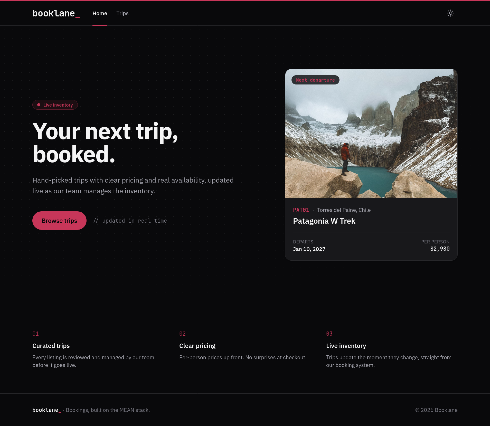
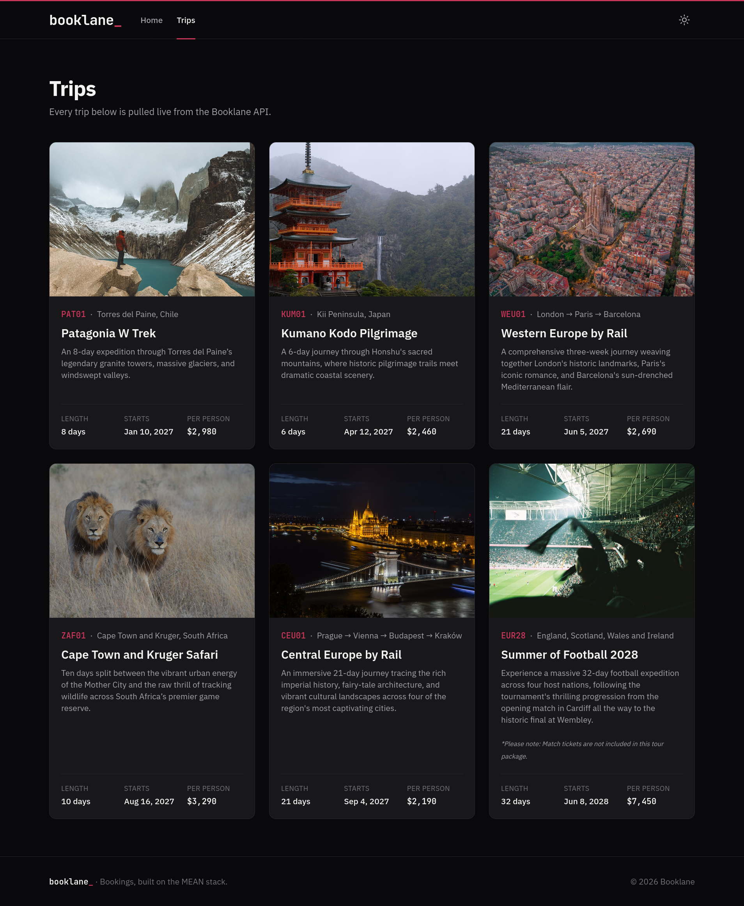
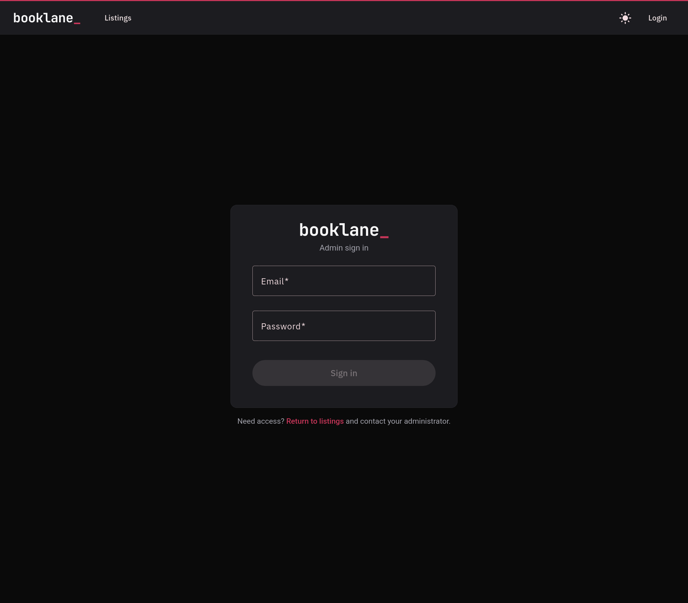
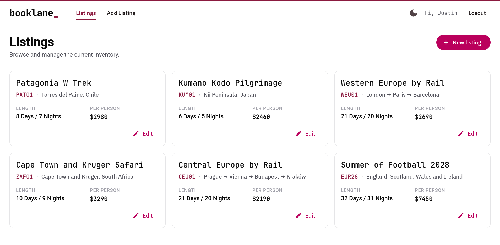
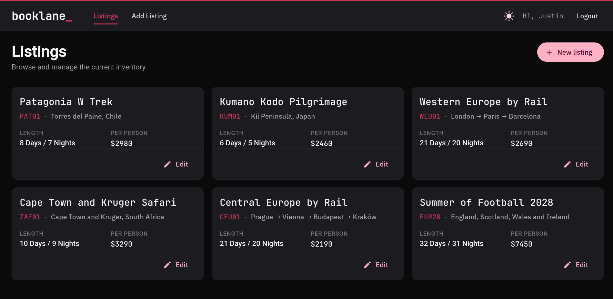
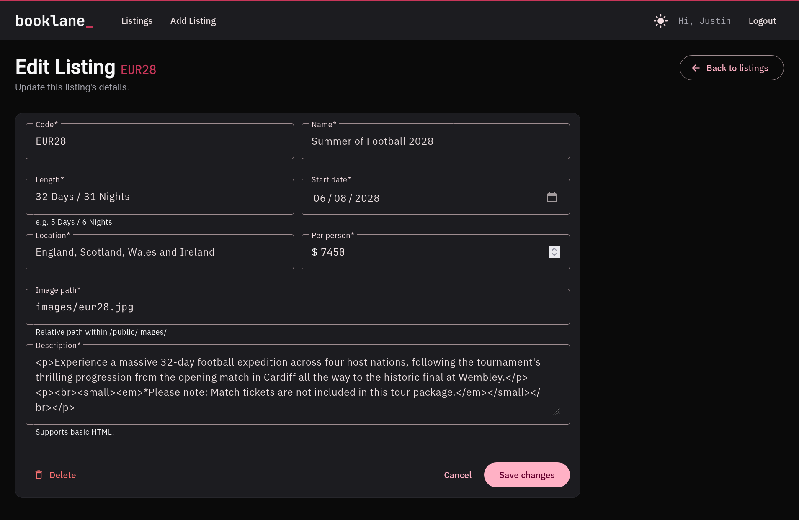
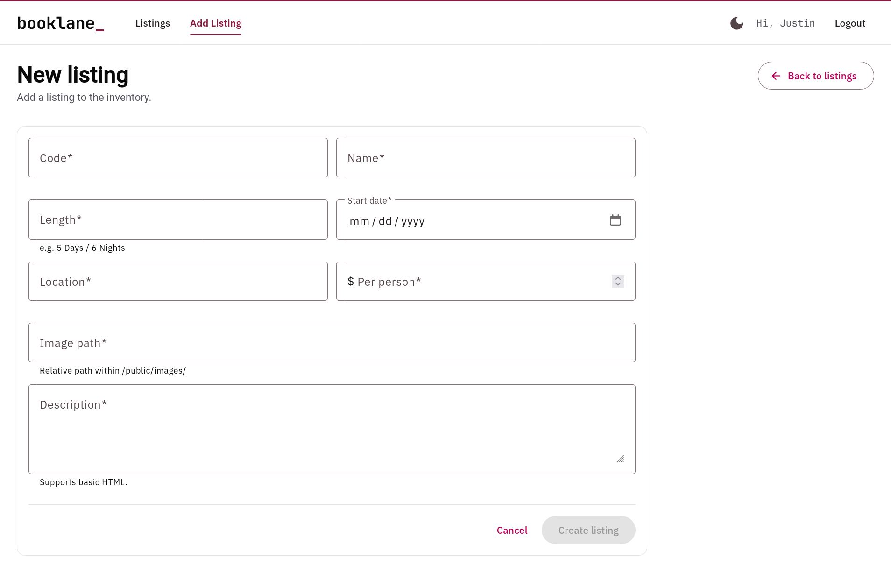

# booklane_

A full-stack travel booking platform built on the MEAN stack. Customers browse trips on a public site, and an admin team manages the inventory from a separate dashboard. Both run off the same API and database, so when a trip changes in the admin, the public site shows it right away.



## What's in here

Booklane is really three apps sharing one backend:

- **Public site** (Express, Handlebars, Tailwind). The storefront. The homepage features whichever trip departs next, and the trips page lists everything with dates and pricing.
- **REST API** (Express, Mongoose). Handles listings and authentication. Anyone can read trips, but creating, editing, or deleting one requires a valid login token.
- **Admin dashboard** (Angular 18, Angular Material). Where the trips get managed. Sign in, add a trip, edit it, or delete it.

Both sides have a dark mode toggle that remembers your choice.

## A look around

| | |
|---|---|
|  |  |
|  |  |
|  |  |

## Things worth pointing out

**Login works end to end.** Signing in returns a JWT, and an HTTP interceptor attaches it to every request, so none of the components have to deal with tokens. A route guard keeps logged-out users away from the edit and add pages. If you open one anyway, it sends you to sign in, then right back to where you were headed.

**Formatting happens on the server.** Prices, dates, and trip lengths come out of the database raw. A shared helper formats them before Handlebars ever sees them: currency, dates in UTC so nothing shows up a day early, and "21 days" instead of "21 Days / 20 Nights" on the cards. The homepage and trips page both use it.

**Validation happens in layers.** The API only accepts the fields it expects, checks trip codes before touching the database, and returns every error in the same shape. Under that, the Mongoose schema enforces required fields, formats, and unique trip codes. One thing I learned the hard way: adding `unique: true` to a Mongoose schema does nothing if the collection already has an old, non-unique index. MongoDB accepted duplicate codes until I dropped the old index and rebuilt it.

**Passwords are never stored.** Each user gets a random salt, and the password is hashed with PBKDF2 using Node's built-in crypto module. Only the hash and the salt get saved.

**The "next departure" card is live.** The homepage pulls every trip from the API, finds the soonest one that hasn't left yet, and features it. When the Patagonia trip departs in January, the homepage moves on to the next one by itself.

## Tech stack

- MongoDB and Mongoose
- Express on Node.js
- Angular 18 (standalone components and signals) with Angular Material
- Handlebars and Tailwind CSS
- JWT authentication with Passport
- IBM Plex Sans and JetBrains Mono

## Running it locally

You'll need Node 20 or newer, and MongoDB running on port 27017. I run Mongo in a container:

```bash
podman run -d --name booklane-mongo -p 27017:27017 mongo:7
```

(Docker works the same way: just swap `podman` for `docker`.)

Clone the repo and install:

```bash
git clone https://github.com/j-naim/Booklane.git
cd Booklane
npm install
```

Create a `.env` file in the project root:

```
PORT=3000
CLIENT_URL=http://localhost:4200
DB_HOST=127.0.0.1
DB_NAME=booklane
JWT_SECRET=replace-with-a-long-random-string
```

You can generate a good secret with:

```bash
node -e "console.log(require('crypto').randomBytes(64).toString('hex'))"
```

Load the sample trips and start the server:

```bash
node seed.js
node app.js
```

The public site is now at http://localhost:3000. Heads up: `seed.js` replaces any trips already in the database.

In a second terminal, start the admin dashboard:

```bash
cd app_admin
npm install
npx ng serve --proxy-config proxy.conf.json
```

That runs at http://localhost:4200.

There's no sign-up page in the admin on purpose, so create your account through the API:

```bash
curl -X POST http://localhost:3000/api/register \
  -H "Content-Type: application/json" \
  -d '{"name":"Admin","email":"admin@example.com","password":"choose-a-password"}'
```

Passwords need at least 8 characters. Then sign in at http://localhost:4200/login.

## API

| Method | Endpoint | Login required | What it does |
|---|---|---|---|
| GET | `/api/listings` | No | All trips, sorted by start date |
| GET | `/api/listings/:code` | No | One trip by its code |
| POST | `/api/listings` | Yes | Create a trip |
| PUT | `/api/listings/:code` | Yes | Update a trip |
| DELETE | `/api/listings/:code` | Yes | Delete a trip |
| POST | `/api/register` | No | Create a user and return a token |
| POST | `/api/login` | No | Sign in and return a token |

Errors always come back as `{ "message": "...", "details": [...] }`. You'll get a 400 for invalid data, 401 for a missing or bad token, 404 when a trip doesn't exist, and 409 if a trip code is already taken.

## Project layout

```
app.js         Express setup, middleware, and routes
seed.js        Loads data/listings.json into MongoDB
app_api/       The REST API: routes, controllers, models, and auth config
app_server/    The public site: controllers, shared helpers, and Handlebars views
app_admin/     The Angular admin dashboard
public/        Static files like trip photos and the favicon
data/          Sample trip data
```

## What's next

- **Bookings.** Right now you can browse trips but not book one, which is a little ironic given the tagline. Next up: a page for each trip, a booking form, and a bookings view in the admin. No real payments, just a clear "demo only" note.
- **Lock down registration.** `/api/register` is open to anyone right now. That's fine locally, but not somewhere public.
- **A live demo,** so you can click around without cloning anything.
- **Tests** for the API, starting with login and validation.
- **A proper Tailwind build.** The CDN version is great for development but isn't meant for production.

## Credits

Trip photos by Marina Zvada (Patagonia), KJ Brix (Kumano Kodo), Archie McNicol (Western Europe), Loek Fernengel (South Africa), Vish Pix (Central Europe), and Altan KENDiRCi (Summer of Football).

## License

MIT. Built by Justin Naimo ([@j-naim](https://github.com/j-naim)).